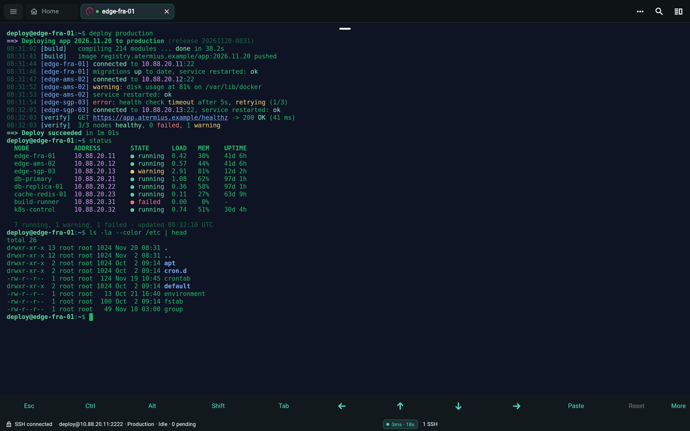

<h1 align="center">Atermius</h1>

One encrypted workspace for SSH, SFTP, RDP and VNC on Android, iOS, Windows, macOS, Linux and the browser, with a sync server you host yourself.

<a href="https://aterm-project.github.io/atermius/"><b>Website</b></a> ·
<a href="https://aterm-project.github.io/atermius/zh/">中文</a> ·
<a href="https://github.com/aterm-project/atermius/releases/latest">Download</a> ·
<a href="https://github.com/aterm-project/atermius/tree/main/docs">Documentation</a> ·
<a href="https://github.com/aterm-project/atermius">Source</a>

## What it is

- **Terminals** for SSH and Telnet, with keyword highlighting in plain output and up to 5,000,000 lines of scrollback; local shell and serial console on desktop.
- **Files** over SFTP and SCP next to the terminal, including copies between two hosts.
- **Remote desktop** over RDP and VNC, through native engines or the gateway of your server.
- **Encrypted sync** through a self-hosted server that stores ciphertext, or encrypted profiles that never leave the device.
- **Teams**: organizations, team Vaults, host sharing and temporary access links.

## Repositories

| Repository | Contents |
| --- | --- |
| [atermius](https://github.com/aterm-project/atermius) | The Flutter client for every platform, the Rust server, documentation and the website |
| [server](https://github.com/aterm-project/server), [web](https://github.com/aterm-project/web), [ios](https://github.com/aterm-project/ios), [desktop](https://github.com/aterm-project/desktop) | Archived on 2026-11-14 when the five repositories were merged into `atermius`; they keep their earlier releases |
